# Locard 6.123 — Generic bounded D2 reasoning

Implemented working tree, 2026-11-10, based on clean main
`30e3b4acde6a0b49fc377177676cf9727eaf8e0d` (6.122). Version authority is
`pyproject.toml`, now **6.123**. Uncommitted; live acceptance remains pending.
The architectural record is `LOCARD_6_123_D2_WIRE_COMPACTION_DESIGN.md`.
This replaces the earlier admission-blocker report after approval of generic compaction.

## Implemented scope

One separately authorized OpenAI request against a selected complete D2-0 packet
from a validated historical transcript. Provider-free previews remain provider-free.
No integration into startup, briefing, B2, C1, D1, replay or automatic investigation
completion. No new forensic lookup, live database connection, persistent D2 journal,
sidecar, retry, fallback, packet substitution or multi-round execution.

```mermaid
flowchart LR
  H[Historical transcript] --> R[D2-0 validated reconstruction]
  R --> P[Generic compact preview and exact body]
  P --> A[Explicit one-shot analyst authorization]
  A --> S[Parent supervisor: 55s work + 5s cleanup]
  S --> W[Gated contained D2 child]
  W --> B[ModelBackend.complete_d2]
  B --> C[Existing cloud worker / LiteLLM]
  C --> G[Final HTTPX serialized-byte gate]
  G --> O[Approved OpenAI model only]
  O --> V[Canonical expansion + existing D2 validator]
  V --> E[Ephemeral unverified result]
```



`d2_execution.prepare/authorize/execute` are backend application services, independent
of CLI parsing. `d2_reasoning` is the explicit module CLI. Existing top-level Locard
commands and historical encodings are unchanged.

## Wire representation and validation

`investigation_ai/d2_wire.py` implements the measured generic `d2c1` view and narrow
response schema. There are no case-, filename-, event- or artifact-specific branches.
Original field descriptors and values remain unchanged. Support tuples are:

`[alias, record_ref, clause_ref, source_ref, field, optional_fields]`

The optional-fields object preserves missing timestamp versus explicit null. All
source context, truncation metadata, interpretation meanings and qualifications stay
visible. Opaque source/read-view/lineage/record identity maps remain in the trusted
canonical packet, bound by its digest. `expand_view()` verifies exact expected
projection and reconstructs the original logical packet; aliases do not establish
independent authority. Source and response validation reuses D2-0, including its
interpretation premises and registered S2 recomputation.

The closed compact response has required keys `s,e,i,c,a,u,g,l,n`: explanatory text,
support aliases, interpretation aliases, contrary support, alternatives, assumptions,
gaps, limitations and suggested examination. It expands into one unverified hypothesis
and one unverified next objective. Request IDs/digests come from the frozen request,
not the model. Assessment is fixed to unresolved and cannot upgrade original S3.
Canonical UTF-8, nonblank, uniqueness, cardinality, reference and dependency checks
remain enforced. Duplicate JSON keys, unknown fields, tools, invented aliases,
oversized/malformed/refused/truncated output fail closed. No partial explanation is
accepted. Valid citations still do not prove prose entailment.

The input can contain registered relationships; this narrow response cannot propose
new authoritative relationships or certify causation/execution. Suggested actions
are never executed. All generated text remains explicitly unverified.

## Authorization, identity and lifecycle

`d2-reasoning-authorization-v1` is an in-memory, one-use capability created only by
`authorize(prepared, confirmation)` after a callback explicitly returns true. It
binds provider/model, source run/manifest/frontier, recorded view, issue ID, canonical
packet digest, exact body hash and limits. Generic configured credentials and old
B1/B2 grants cannot authorize it. The service rejects modified preparation or grants,
expired/reused permits and changed selected provider/model. No external serialized
grant import is provided.

Limits: one attempt/round, 5,600 body bytes, 1,024 output tokens, 60 seconds including
five reserved cleanup seconds, zero retries/lookups/fallback. Approval starts the
monotonic clock. A contained child reopens only the transcript, reconstructs and
revalidates the exact source/packet, checks provider preferences, then calls the
configured ModelBackend. The parent bounds startup, reconstruction, model execution
and result validation to 55 seconds. Cleanup uses the remaining five seconds.
Existing `Launch`, `WorkerJob` and `_stop` containment are reused; unconfirmed cleanup
raises `CleanupError` with `CLEANUP_LIMITATION` rather than claiming success.

A cancelled request before launch never dispatches. Parent cancellation/timeout
terminates controlled workers/descendants. D2 bypasses readiness *requests*, not
source or authorization checks: `complete_d2` does not invoke `prepare`, probe a
model, initialize local runtime or fall back. Missing credentials/dependencies and
provider incompatibility fail this one attempt. Source preparation and analyst review
before authorization are provider-free and outside the approved execution allocation.

Results are memory/terminal-only: accepted, rejected or interrupted. `durable=false`
is explicit. No old transcript is appended. Raw diagnostic capture is disabled for
this operation. Default failure output contains sanitized categories, not provider
exception text. Attempt allocation is consumed once; `attempts` counts worker-entered
provider attempts, not proven network delivery. If cancellation races the IPC attempt notification, attempts are explicitly unknown
(at most one) and possible exposure is retained. Exposure may be uncertain after a
failed/cancelled call. Usage is provider-reported when available; missing usage is
unknown, not zero.

## Actual request-body admission

`ai/d2_transport.py` supplies an OpenAI client to the existing LiteLLM cloud-worker
route, with a guarding HTTPX transport. It verifies exact bytes, size, method and
endpoint **before** calling the underlying network transport, and rejects a second
send. OpenAI SDK retries and LiteLLM retries are zero; redirects are disabled.

Preview uses the same HTTPX JSON serializer and explicit OpenAI request field order:
messages, model, max_completion_tokens and strict response_format. Canonical-to-wire
schema adaptation is registered by exact D2 schema equality in `ai/openai_schema.py`.
At dispatch the actual SDK body must equal the approved bytes exactly. Any SDK-added,
changed or reordered field fails closed before network rather than reusing a stale
size estimate. This intentionally makes unsupported SDK encoding changes actionable
compatibility failures, not permission to send different evidence.

The 5,600-byte cap covers the full JSON entity, including schema, instructions,
provider fields and escaping. HTTP headers/TLS framing are outside that body contract.
The explicit approved model is `config.model`, never model-generated.

## Measurements and generic acceptance

The implemented serializer reproduces historical benchmark sizes: mandatory bundle
4,996; selected additional EventData 5,324; added MFT context 5,996 (reject); larger
relationship bundle 9,307 (reject). Historical bundles are read-only capacity probes,
not case-specific selector rules. The public service selects existing complete D2-0
preview packets; it does not expose an ad-hoc bundle constructor or silently repack
an over-budget packet. A source issue with no complete D2-0 packet stays unavailable.

Actual LiteLLM 1.106.0 / OpenAI 2.54.0 / HTTPX 0.28.1 mocked transport checks reproduce:

| Generic fixture | Complete bytes | Admission |
|---|---:|---|
| Browser only | 3,399 | Fits |
| Registry persistence metadata | 3,592 | Fits |
| Process/service activity | 4,518 | Fits |
| MFT without EVTX | 3,789 | Fits |
| Prefetch only | 3,523 | Fits |
| Four-family bundle | 6,047 | Reject intact |
| Two-family bundle | 4,436 | Fits |
| Shared-path registered relationship | 4,558 | Fits |
| No supported relationships | 3,232 | Fits |
| Conflicting source assertions/incomplete evidence | 4,670 | Fits |
| Large original value | 5,481 | Fits |
| Extensive qualifications | 7,096 | Reject intact |
| Larger original value | 5,881 | Reject intact |

All 13 have exact canonical round-trip checks and nine independent mutation classes
(value, alias, source, epoch, type, truncation, qualifications, relationship, version):
117 negative projection checks. Cross-family instruction-bearing artifact values stay
data and cannot change grants, tool availability, model selection or response schema.
The same finite capacity limitations remain: fitting one fixture does not imply all
investigations fit. No source value or qualifier was shortened to meet these numbers.

## Focused validation and historical compatibility

- Broader relevant regression set: **238 passed in 104.19 seconds** (D2, B1/B2,
  OpenAI schema, empty-state replay and D1b compact profiles).
- Final execution-focused set after cancellation/accounting review and the full-service
  mock test: **57 passed in 16.70 seconds**.
- Actual installed SDK transport set: **22 passed in 9.79 seconds**, with one upstream
  Pydantic ReadOnly warning. Success/refusal/truncation/provider failure each made one
  mock transport attempt; no retry. Ten admitted generic fixtures reached only the
  HTTP mock; the three oversized fixtures reached no transport. No real requests.
- The end-to-end synthetic-history supervisor, timeout and cancellation subset also
  passed **3/3 in 9.31 seconds** before the final execution-focused rerun.

The first two cleanup tests failed because the test fixture changed its history root
before authorization validation; the fixture was corrected, preserving production
source checks. The installed SDK's background threads delayed ordinary pytest exit
on the first transport-only invocation after its nine tests had passed. That owned
run was interrupted. Final SDK checks used a one-shot test runner that flushes output
and exits with pytest's status, matching the existing cloud worker's process-exit
pattern; no production cleanup safeguards were removed. No full suite was run.

An independent committed-HEAD source export was compared with the working tree in
separate Python processes. All B1/B2/D1/D1b/D2 reconstruction outputs (or existing
rejections) matched for the three copied 6.118 runs and copied 6.111 run. Every inspected
manifest/events SHA-256 stayed unchanged. The 6.111 explanation digest remains:
`36121cbc44ec2f3577ec9ecaae946f444a36abdeb4f33e607ae17b5b2d6399fc`.
The zero-analysis run's D1 page builder raises `Cross-view explanation` in both HEAD
and the working tree; this is an existing limitation, not repaired in D2 scope.
Its B1/B2/D1b/D2 reconstruction succeeds unchanged. No live case was opened.

## Manual acceptance commands

After the analyst commits/pushes and updates the separate test checkout, install there:

```powershell
Set-Location C:\tmp\locard260927\locard
.\.venv\Scripts\python.exe -m pip install -e .
.\.venv\Scripts\python.exe -c "from importlib.metadata import version; print(version('locard-forensics'))"
```

Expected installed version: **6.123**. Installation was not performed by this task.
Use the existing intentionally configured OpenAI model. D2 never changes provider
settings or runs a readiness probe on the analyst's behalf.

List issues without a provider request:

```powershell
.\.venv\Scripts\python.exe -B -m forensic_assistant.investigation_ai.d2_reasoning 'C:\tmp\locard-diagnostics\6.118-live' 6ad0c85499564406aa4d949f3b0e72e5 --exploratory --json
```

Copy an eligible issue ID from that output into `$issueId`. Inspect the **exact**
canonical packet, wire messages, body size/hash, source bindings and unchanged S3:

```powershell
$issueId = '<issue ID from preview>'
.\.venv\Scripts\python.exe -B -m forensic_assistant.investigation_ai.d2_reasoning 'C:\tmp\locard-diagnostics\6.118-live' 6ad0c85499564406aa4d949f3b0e72e5 --exploratory --issue $issueId --json
```

Only the following optional command can prompt for a live request. It requires
`--execute`, the selected issue and an explicit `y` after displaying provider/model,
source frontier, packet digest, byte count and limits. This live action is for the
analyst, not part of automated validation:

```powershell
.\.venv\Scripts\python.exe -B -m forensic_assistant.investigation_ai.d2_reasoning 'C:\tmp\locard-diagnostics\6.118-live' 6ad0c85499564406aa4d949f3b0e72e5 --exploratory --issue $issueId --execute
```

Review recorded support/registered interpretations separately from the unverified
AI explanation, alternatives, unresolved gaps and suggested examination. Verify
original S3 remains unchanged. Failure produces no validated AI explanation and
never retries/substitutes/falls back. A successful display is ephemeral, not saved.

Optional file-integrity check around manual acceptance:

```powershell
$runDir = 'C:\tmp\locard-diagnostics\6.118-live\6ad0c85499564406aa4d949f3b0e72e5'
$before = Get-FileHash -Algorithm SHA256 -LiteralPath "$runDir\manifest.json","$runDir\events.jsonl"
# Run the chosen preview or separately authorized execution here.
$after = Get-FileHash -Algorithm SHA256 -LiteralPath "$runDir\manifest.json","$runDir\events.jsonl"
Compare-Object $before $after -Property Path,Hash
```

No differences are expected. This validates these operations, not pre-existing
historical evidence integrity. API usage for a web UI follows the same boundary:
`prepare(root, run, issue, config, exploratory=...)`, `preview()`, explicit
`authorize(prepared, confirmation_callback)`, then `execute(permit)` once.
No CLI parsing is required by the service.

## Files and limitations

Production: `investigation_ai/d2_wire.py`, `d2_execution.py`, `d2_reasoning.py`,
`ai/d2_transport.py`; narrow integration changes in `ai/backend.py`, `cloud_worker.py`,
`openai_schema.py`; version in `pyproject.toml`. Tests: `d2_generic_fixtures.py`,
`test_d2_execution.py`, `test_d2_transport.py`. This document is updated; the approved
wire design is preserved. No B1/B2/C1/D1 historical contracts were changed.

OpenAI is the only D2 execution provider in this release. The ordinary provider
abstraction remains available to existing workflows. Remote schema acceptance,
model response quality and actual live usage are not established by mocks. The next
phase, if approved, is live acceptance followed by separately designed durable D2
state; no continuation/recovery/journaling is implied here. `git diff --check` passed. No commit or push.
